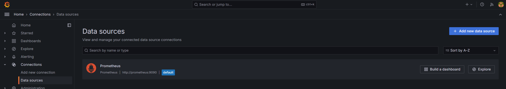
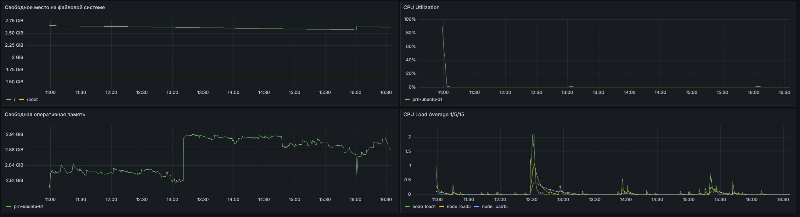
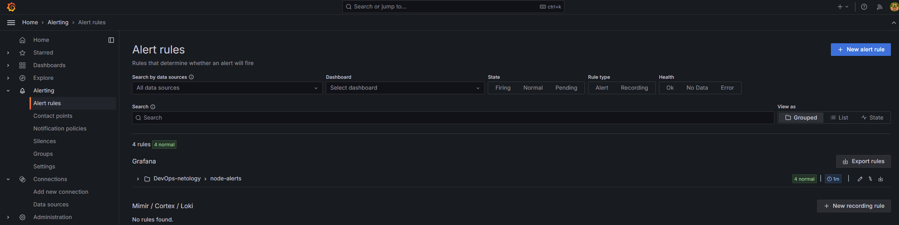
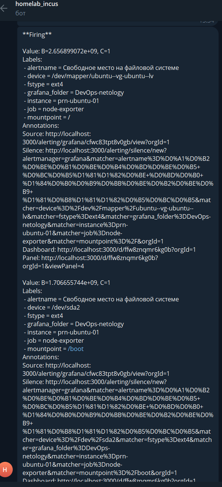

# Домашнее задание к занятию 14 «Средство визуализации Grafana»

Выполнено в варианте **повышенной сложности**: стек развёрнут самостоятельно, без использования
директории `help`. Каналом нотификации выбран Telegram.

## Окружение

| Компонент | Версия |
|---|---|
| Хост | `prn-ubuntu-01`, Ubuntu 24.04 |
| Docker Compose | v2 |
| Grafana | 11.1.0 |
| Prometheus | v2.53.0 |
| node-exporter | v1.8.1 |

Структура каталога:

```
14-monitoring-04-grafana/
├── README.md
├── docker-compose.yml
├── dashboard.json
├── prometheus/
│   └── prometheus.yml
├── grafana/
│   └── provisioning/
│       └── datasources/
│           └── prometheus.yml
└── img/
```

---

## Задание 1. Развёртывание стека и подключение Datasource

### docker-compose.yml

```yaml
name: monitoring

services:
  prometheus:
    image: prom/prometheus:v2.53.0
    container_name: prometheus
    volumes:
      - ./prometheus/prometheus.yml:/etc/prometheus/prometheus.yml:ro
      - prometheus_data:/prometheus
    command:
      - '--config.file=/etc/prometheus/prometheus.yml'
      - '--storage.tsdb.path=/prometheus'
      - '--storage.tsdb.retention.time=15d'
      - '--web.enable-lifecycle'
    ports:
      - "9090:9090"
    restart: unless-stopped

  node-exporter:
    image: prom/node-exporter:v1.8.1
    container_name: node-exporter
    command:
      - '--path.procfs=/host/proc'
      - '--path.sysfs=/host/sys'
      - '--path.rootfs=/rootfs'
      - '--collector.filesystem.mount-points-exclude=^/(sys|proc|dev|host|etc)($$|/)'
    volumes:
      - /proc:/host/proc:ro
      - /sys:/host/sys:ro
      - /:/rootfs:ro
    ports:
      - "9100:9100"
    pid: host
    restart: unless-stopped

  grafana:
    image: grafana/grafana:11.1.0
    container_name: grafana
    environment:
      GF_SECURITY_ADMIN_USER: admin
      GF_SECURITY_ADMIN_PASSWORD: admin
      GF_USERS_ALLOW_SIGN_UP: "false"
      HTTPS_PROXY: http://172.18.0.1:10809
      HTTP_PROXY: http://172.18.0.1:10809
      NO_PROXY: prometheus,localhost,127.0.0.1
    volumes:
      - grafana_data:/var/lib/grafana
      - ./grafana/provisioning:/etc/grafana/provisioning:ro
    ports:
      - "3000:3000"
    depends_on:
      - prometheus
    restart: unless-stopped

volumes:
  prometheus_data:
  grafana_data:
```

Ключевые моменты конфигурации:

- `$$` в аргументе `--collector.filesystem.mount-points-exclude` — экранирование `$`
  для Docker Compose, иначе он попытается подставить переменную окружения;
- node-exporter монтирует `/proc`, `/sys` и `/` хоста в режиме read-only и получает
  `pid: host` — иначе метрики отражали бы состояние контейнера, а не хоста;
- переменные `*_PROXY` у Grafana — см. раздел «Решение проблемы сетевой доступности».

### prometheus/prometheus.yml

```yaml
global:
  scrape_interval: 15s
  evaluation_interval: 15s

scrape_configs:
  - job_name: 'prometheus'
    static_configs:
      - targets: ['localhost:9090']

  - job_name: 'node-exporter'
    static_configs:
      - targets: ['node-exporter:9100']
        labels:
          instance: 'prn-ubuntu-01'
```

### grafana/provisioning/datasources/prometheus.yml

Источник данных подключён через механизм provisioning — при старте контейнера Grafana
читает файлы из `/etc/grafana/provisioning/datasources/` и создаёт datasource автоматически,
без ручной настройки через UI.

```yaml
apiVersion: 1

datasources:
  - name: Prometheus
    type: prometheus
    access: proxy
    url: http://prometheus:9090
    isDefault: true
    editable: true
```

`access: proxy` означает, что запросы к Prometheus идёт сама Grafana со стороны сервера,
а не браузер пользователя — поэтому в URL используется DNS-имя сервиса внутри compose-сети.

### Запуск и проверка

```bash
docker compose up -d
docker compose ps
```

```
NAME            IMAGE                       STATUS          PORTS
grafana         grafana/grafana:11.1.0      Up              0.0.0.0:3000->3000/tcp
node-exporter   prom/node-exporter:v1.8.1   Up              0.0.0.0:9100->9100/tcp
prometheus      prom/prometheus:v2.53.0     Up              0.0.0.0:9090->9090/tcp
```

Проверка сбора метрик:

```bash
curl -s localhost:9100/metrics | grep -E '^node_load1 |^node_memory_MemAvailable_bytes'
curl -s 'localhost:9090/api/v1/targets?state=active' | grep -o '"health":"[a-z]*"'
curl -s 'localhost:9090/api/v1/query?query=up' | grep -o '"job":"[^"]*"'
```

```
node_load1 0.73
node_memory_MemAvailable_bytes 3.009449984e+09
"health":"up"
"health":"up"
"job":"prometheus"
"job":"node-exporter"
```

Оба таргета в состоянии `up`.

**Результат:**



---

## Задание 2. Dashboard и PromQL-запросы

### Утилизация CPU (в процентах, 100-idle)

```promql
100 - (avg by (instance) (rate(node_cpu_seconds_total{mode="idle"}[5m])) * 100)
```

`node_cpu_seconds_total` — counter, накапливающий секунды, проведённые каждым ядром в каждом
режиме. `rate(...[5m])` переводит его в «секунд простоя в секунду», то есть в долю от 0 до 1.
`avg by (instance)` усредняет по всем ядрам хоста — без этого получилась бы отдельная серия
на каждое ядро. Результат умножается на 100 и вычитается из 100.

Настройки панели: Unit — `Percent (0-100)`, Min `0`, Max `100`.

### CPU Load Average 1/5/15

Три запроса в одной панели:

```promql
node_load1
node_load5
node_load15
```

Метрики типа gauge — мгновенные значения, `rate` не требуется. Для каждого запроса задано
собственное поле Legend, иначе в легенду выводится полный набор лейблов.

Unit — `short`.

### Количество свободной оперативной памяти

```promql
node_memory_MemAvailable_bytes
```

Использован `MemAvailable`, а не `MemFree`: `MemFree` показывает только полностью нетронутую
память, которая на работающей системе всегда близка к нулю, поскольку ядро отдаёт свободные
страницы под page cache. `MemAvailable` — оценка ядра, сколько памяти реально можно выделить
процессу без обращения к свопу.

Unit — `bytes(IEC)`.

### Количество места на файловой системе

```promql
node_filesystem_avail_bytes{fstype!~"tmpfs|squashfs|overlay|fuse.lxcfs"}
```

Фильтр по `fstype` отсекает псевдо-файловые системы (snap-пакеты, слои Docker), которые иначе
добавили бы десятки бессмысленных серий. Legend задан как `{{mountpoint}}`.

Unit — `bytes(IEC)`.

**Результат:**



---

## Задание 3. Alerting и канал нотификации

### Решение проблемы сетевой доступности

С хоста `prn-ubuntu-01` домен `api.telegram.org` оказался недоступен: DNS резолвился корректно
(`149.154.166.110`), но TCP-соединение не устанавливалось, при том что остальной IPv4-интернет
работал.

```bash
$ curl -4 -s -m 5 -o /dev/null -w '%{http_code}\n' https://api.telegram.org
000
$ curl -4 -s -m 5 -o /dev/null -w '%{http_code}\n' https://api.github.com
200
```

Решение — развернуть на хосте Xray (VLESS + Reality) в режиме локального прокси-сервера:

```bash
sudo bash -c "$(curl -L https://github.com/XTLS/Xray-install/raw/main/install-release.sh)" @ install
```

В конфиге `/usr/local/etc/xray/config.json` inbound'ы подняты на `0.0.0.0` вместо `127.0.0.1` —
иначе контейнер Grafana не смог бы обратиться к прокси, так как хостовый loopback недоступен
из сетевого namespace контейнера:

```json
{
  "inbounds": [
    {"listen": "0.0.0.0", "port": 10808, "protocol": "socks",
     "settings": {"auth": "noauth", "udp": true}, "tag": "socks"},
    {"listen": "0.0.0.0", "port": 10809, "protocol": "http", "tag": "http"}
  ],
  "outbounds": [
    {"protocol": "vless", "settings": {"vnext": [{"address": "<VPN_SERVER>", "port": 443,
      "users": [{"id": "<UUID>", "flow": "xtls-rprx-vision", "encryption": "none"}]}]},
     "streamSettings": {"network": "tcp", "security": "reality",
      "realitySettings": {"publicKey": "<PUBLIC_KEY>", "serverName": "<SNI>",
       "shortId": "<SHORT_ID>", "fingerprint": "firefox"}},
     "tag": "proxy"},
    {"protocol": "freedom", "tag": "direct"}
  ],
  "routing": {
    "domainStrategy": "IPIfNonMatch",
    "rules": [
      {"type": "field",
       "ip": ["10.0.0.0/8", "172.16.0.0/12", "192.168.0.0/16", "169.254.0.0/16", "224.0.0.0/4"],
       "outboundTag": "direct"}
    ]
  }
}
```

Правило маршрутизации отправляет трафик к приватным подсетям (включая `172.18.0.0/16` — сеть
Docker) напрямую, минуя туннель.

Реквизиты подключения к VPN-серверу в листинге заменены плейсхолдерами.

```bash
sudo systemctl enable --now xray
curl -s -m 10 --socks5-hostname 127.0.0.1:10808 -o /dev/null -w '%{http_code}\n' https://api.telegram.org
```

```
302
```

Grafana направляется на прокси через переменные окружения `HTTP_PROXY` / `HTTPS_PROXY`
(см. `docker-compose.yml`). Переменная `NO_PROXY` обязательна: без неё запросы к Prometheus
также уходили бы в туннель и datasource перестал бы работать.

Проверка после применения:

```bash
$ docker exec grafana wget -qO- --timeout=5 http://prometheus:9090/-/healthy
Prometheus Server is Healthy.
```

### Contact point

**Alerting → Contact points → New contact point**, тип Telegram:

| Поле | Значение |
|---|---|
| Name | `telegram-devops` |
| Integration | Telegram |
| BOT API Token | токен, полученный у `@BotFather` |
| Chat ID | получен через `getUpdates` |

Chat ID определён запросом к Bot API через прокси:

```bash
curl -s --socks5-hostname 127.0.0.1:10808 "https://api.telegram.org/bot${TOKEN}/getUpdates"
```

Созданный contact point назначен в **Alerting → Notification policies** каналом по умолчанию —
иначе уведомления уходили бы в неработающий `grafana-default-email`.

### Правила алертов

Правила созданы с панелей дашборда (меню панели → More → New alert rule). Каждое правило
состоит из трёх блоков: запрос `A`, свёртка `B` (Reduce, функция `Last`) и порог `C` (Threshold).

| Панель | Условие | Порог |
|---|---|---|
| CPU Utilization | `IS ABOVE` | 80 (%) |
| CPU Load Average 1/5/15 | `IS ABOVE` | 2 |
| Свободная оперативная память | `IS BELOW` | 536870912 (512 MiB) |
| Свободное место на файловой системе | `IS BELOW` | 5368709120 (5 GiB) |

Общие параметры: folder `DevOps-netology`, evaluation group `node-alerts` с интервалом `1m`,
pending period `2m`. Pending period отсекает кратковременные пики — правило переходит в
состояние Firing только если условие выполняется два цикла проверки подряд.

**Результат — список правил:**



### Тестовое событие в Telegram

Сработало правило по свободному месту на файловой системе. Важная особенность: запрос вернул
две серии (по одной на точку монтирования), и Grafana создала **два независимых экземпляра
алерта** — по одному на каждый уникальный набор лейблов. Каждый экземпляр имеет собственное
состояние и разрешается независимо от остальных.

```
Firing

Value: B=2.656899072e+09, C=1
Labels:
 - alertname = Свободное место на файловой системе
 - device = /dev/mapper/ubuntu--vg-ubuntu--lv
 - fstype = ext4
 - instance = prn-ubuntu-01
 - mountpoint = /

Value: B=1.706655744e+09, C=1
Labels:
 - alertname = Свободное место на файловой системе
 - device = /dev/sda2
 - fstype = ext4
 - instance = prn-ubuntu-01
 - mountpoint = /boot
```



---

## Задание 4. JSON Model

Модель дашборда выгружена через **Dashboard settings → JSON Model** и сохранена в файл
[dashboard.json](./dashboard.json).

```bash
$ python3 -m json.tool dashboard.json > /dev/null && echo "JSON OK"
JSON OK
$ ls -lh dashboard.json
-rw-rw-r-- 1 zolotkoff zolotkoff 12K Aug 26 11:19 dashboard.json
```

---

## Выводы

- Provisioning datasources через YAML-файлы избавляет от ручной настройки источников данных
  и делает конфигурацию Grafana воспроизводимой — стек поднимается из чистого состояния
  одной командой `docker compose up -d`.
- node-exporter в контейнере требует явного проброса `/proc`, `/sys`, `/` и `pid: host`,
  иначе собираются метрики контейнера, а не хоста.
- Одно правило алерта порождает столько экземпляров, сколько серий вернул запрос. Это нужно
  учитывать при выборе порогов: для файловых систем разного размера абсолютный порог в
  байтах даёт ложные срабатывания, относительный (процент свободного места) универсальнее.
- Grafana написана на Go и корректно обрабатывает стандартные переменные `HTTP_PROXY` /
  `HTTPS_PROXY`, что позволяет направить только исходящие уведомления через прокси, не
  затрагивая сетевую конфигурацию хоста.

### Известные ограничения

- Пароль администратора Grafana задан в открытом виде в `docker-compose.yml` — приемлемо
  для учебного стенда, в production выносится в secrets.
- Работа канала нотификации зависит от запущенного сервиса `xray` на хосте.
