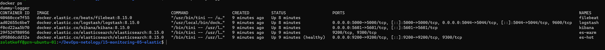
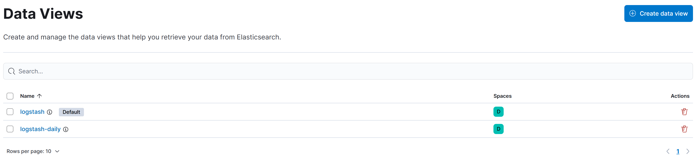
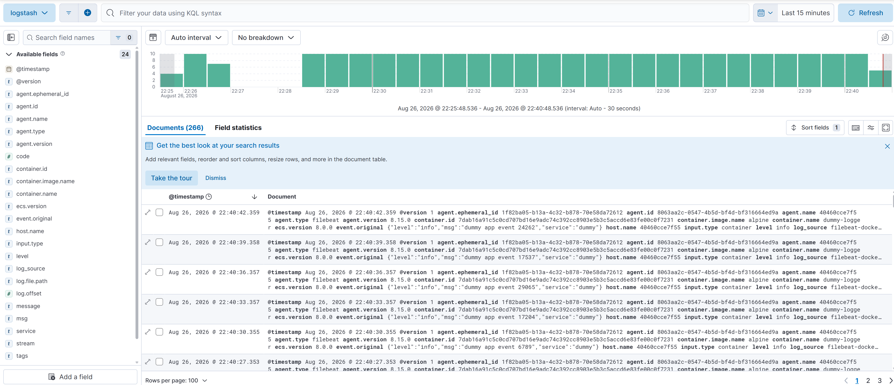
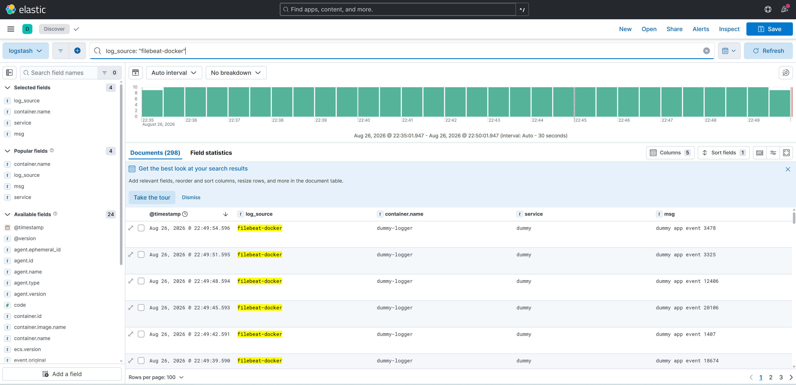

# Домашнее задание к занятию 15 «Система сбора логов Elastic Stack»

Выполнено в варианте **повышенной сложности**: стек развёрнут самостоятельно, без использования
директории `help`.

## Окружение

| Компонент | Версия |
|---|---|
| Хост | `prn-ubuntu-01`, Ubuntu 24.04, 4 GB RAM, 24 GB диск |
| Docker Compose | v2.40.3 |
| Elasticsearch | 8.15.0 (2 ноды: hot + warm) |
| Logstash | 8.15.0 |
| Kibana | 8.15.0 |
| Filebeat | 8.15.0 |

Структура каталога:

```
15-monitoring-05-elastic/
├── README.md
├── docker-compose.yml
├── logstash/
│   └── pipeline/
│       └── logstash.conf
├── filebeat/
│   └── filebeat.yml
└── img/
```

## Схема стека

```
docker logs ──> filebeat ──> logstash :5044 (beats) ──┐
                                                       ├──> elasticsearch (hot + warm) <── kibana
              tcp json ─────> logstash :5000 (tcp) ────┘
```

---

## Подготовка хоста

Elasticsearch не стартует с дефолтным лимитом mmap — падает с ошибкой
`max virtual memory areas vm.max_map_count [65530] is too low`:

```bash
sudo sysctl -w vm.max_map_count=262144
echo 'vm.max_map_count=262144' | sudo tee -a /etc/sysctl.conf
```

---

## Задание 1. Развёртывание стека

### docker-compose.yml

```yaml
name: elastic

services:
  es-hot:
    image: docker.elastic.co/elasticsearch/elasticsearch:8.15.0
    container_name: es-hot
    environment:
      node.name: es-hot
      node.roles: '["master","data_hot","data_content","ingest"]'
      cluster.name: netology-cluster
      cluster.initial_master_nodes: es-hot,es-warm
      discovery.seed_hosts: es-warm
      bootstrap.memory_lock: "true"
      xpack.security.enabled: "false"
      xpack.license.self_generated.type: basic
      ES_JAVA_OPTS: "-Xms512m -Xmx512m"
    ulimits:
      memlock:
        soft: -1
        hard: -1
      nofile:
        soft: 65536
        hard: 65536
    volumes:
      - es_hot_data:/usr/share/elasticsearch/data
    ports:
      - "9200:9200"
    healthcheck:
      test: ["CMD-SHELL", "curl -s http://localhost:9200/_cluster/health | grep -qE 'green|yellow'"]
      interval: 15s
      timeout: 10s
      retries: 20
    logging:
      driver: json-file
      options:
        max-size: "10m"
        max-file: "3"
    restart: unless-stopped

  es-warm:
    image: docker.elastic.co/elasticsearch/elasticsearch:8.15.0
    container_name: es-warm
    environment:
      node.name: es-warm
      node.roles: '["master","data_warm","data_content"]'
      cluster.name: netology-cluster
      cluster.initial_master_nodes: es-hot,es-warm
      discovery.seed_hosts: es-hot
      bootstrap.memory_lock: "true"
      xpack.security.enabled: "false"
      xpack.license.self_generated.type: basic
      ES_JAVA_OPTS: "-Xms512m -Xmx512m"
    ulimits:
      memlock:
        soft: -1
        hard: -1
      nofile:
        soft: 65536
        hard: 65536
    volumes:
      - es_warm_data:/usr/share/elasticsearch/data
    logging:
      driver: json-file
      options:
        max-size: "10m"
        max-file: "3"
    restart: unless-stopped

  logstash:
    image: docker.elastic.co/logstash/logstash:8.15.0
    container_name: logstash
    environment:
      LS_JAVA_OPTS: "-Xms256m -Xmx256m"
      xpack.monitoring.enabled: "false"
    volumes:
      - ./logstash/pipeline:/usr/share/logstash/pipeline:ro
    ports:
      - "5044:5044"
      - "5000:5000"
    depends_on:
      es-hot:
        condition: service_healthy
    logging:
      driver: json-file
      options:
        max-size: "10m"
        max-file: "3"
    restart: unless-stopped

  kibana:
    image: docker.elastic.co/kibana/kibana:8.15.0
    container_name: kibana
    environment:
      SERVER_NAME: kibana
      ELASTICSEARCH_HOSTS: '["http://es-hot:9200"]'
      NODE_OPTIONS: "--max-old-space-size=400"
    ports:
      - "5601:5601"
    depends_on:
      es-hot:
        condition: service_healthy
    logging:
      driver: json-file
      options:
        max-size: "10m"
        max-file: "3"
    restart: unless-stopped

  filebeat:
    image: docker.elastic.co/beats/filebeat:8.15.0
    container_name: filebeat
    user: root
    command: ["--strict.perms=false"]
    volumes:
      - ./filebeat/filebeat.yml:/usr/share/filebeat/filebeat.yml:ro
      - /var/lib/docker/containers:/var/lib/docker/containers:ro
      - /var/run/docker.sock:/var/run/docker.sock:ro
    depends_on:
      - logstash
    logging:
      driver: json-file
      options:
        max-size: "10m"
        max-file: "3"
    restart: unless-stopped

volumes:
  es_hot_data:
  es_warm_data:
```

Ключевые решения:

- **`node.roles`** задаёт специализацию нод: `data_hot` для горячих данных, `data_warm` для
  тёплых. Обе ноды оставлены master-кандидатами, иначе кластер из двух узлов не выберет
  мастера при рестарте одной из них.
- **`bootstrap.memory_lock` + `ulimits.memlock`** запрещают свопить heap. Elasticsearch крайне
  чувствителен к подкачке: при активном свопе начинает таймаутить и выпадать из кластера.
- **`healthcheck` + `condition: service_healthy`** — без этого Logstash и Kibana стартуют
  раньше, чем Elasticsearch готов принимать запросы, падают и уходят в цикл перезапусков.
- **Heap ужат до 512m/512m/256m** под ограничение хоста в 4 GB RAM. По умолчанию Elasticsearch
  забирает половину доступной памяти, и две ноды со стандартными настройками на такой машине
  не поднялись бы.
- **Ротация логов** (`max-size: 10m`, `max-file: 3`) — см. раздел «Петля обратной связи».

### logstash/pipeline/logstash.conf

```
input {
  # приём логов от filebeat
  beats {
    port => 5044
  }

  # приём json-сообщений по tcp (требование задания)
  tcp {
    port => 5000
    codec => json_lines
  }
}

filter {
  # помечаем источник, чтобы отличать beats от tcp в Discover
  if [agent][type] == "filebeat" {
    mutate {
      add_field => { "log_source" => "filebeat-docker" }
    }
  } else {
    mutate {
      add_field => { "log_source" => "tcp-json" }
    }
  }
}

output {
  elasticsearch {
    hosts => ["http://es-hot:9200"]
    index => "logstash-%{+YYYY.MM.dd}"
  }

  # ВАЖНО: вывод в stdout намеренно отключён — см. раздел «Петля обратной связи»
  # stdout { codec => rubydebug }
}
```

Поле `log_source` добавляется в фильтре и позволяет в Kibana разделить два потока: события
от filebeat и события, пришедшие напрямую по tcp.

### filebeat/filebeat.yml

```yaml
filebeat.inputs:
  - type: container
    enabled: true
    paths:
      - /var/lib/docker/containers/*/*.log

processors:
  # обогащаем записи метаданными: имя контейнера, образ, лейблы
  - add_docker_metadata:
      host: "unix:///var/run/docker.sock"

  # исключаем контейнеры самого стека, чтобы не гонять логи по кругу
  - drop_event:
      when:
        or:
          - equals: {container.name: "logstash"}
          - equals: {container.name: "filebeat"}
          - equals: {container.name: "kibana"}
          - equals: {container.name: "es-hot"}
          - equals: {container.name: "es-warm"}

  # раскрываем json внутри поля message, если он там есть
  - decode_json_fields:
      fields: ["message"]
      target: ""
      overwrite_keys: true
      max_depth: 1

output.logstash:
  hosts: ["logstash:5044"]

logging.level: info
logging.to_files: false
```

Filebeat монтирует `/var/lib/docker/containers` — физическое расположение json-логов
контейнеров при драйвере `json-file`, и `docker.sock` — для обогащения записей метаданными.

### Результат: пять запущенных контейнеров

```
NAME       IMAGE                                                  STATUS
es-hot     docker.elastic.co/elasticsearch/elasticsearch:8.15.0   Up 37 minutes (healthy)
es-warm    docker.elastic.co/elasticsearch/elasticsearch:8.15.0   Up 37 minutes
filebeat   docker.elastic.co/beats/filebeat:8.15.0                Up 36 minutes
kibana     docker.elastic.co/kibana/kibana:8.15.0                 Up 36 minutes
logstash   docker.elastic.co/logstash/logstash:8.15.0             Up 36 minutes
```



### Состояние кластера

```bash
$ curl -s 'localhost:9200/_cat/nodes?v&h=name,node.role,heap.percent,master'
name    node.role heap.percent master
es-hot  hims                43 -
es-warm msw                 33 *

$ curl -s localhost:9200/_cluster/health?pretty
{
  "cluster_name" : "netology-cluster",
  "status" : "green",
  "number_of_nodes" : 2,
  "number_of_data_nodes" : 2,
  "active_primary_shards" : 31,
  "active_shards" : 59
}
```

Роли расшифровываются так: у `es-hot` — `hims` (hot, ingest, master, content),
у `es-warm` — `msw` (master, content, warm). Звёздочка в колонке `master` показывает
текущего выбранного мастера.

### Проверка обоих входов Logstash

**TCP/JSON (порт 5000):**

```bash
for i in $(seq 1 20); do
  echo "{\"message\":\"random event $RANDOM\",\"level\":\"info\",\"service\":\"dummy-app\"}" \
    | nc -q0 localhost 5000
  sleep 1
done
```

```bash
$ curl -s 'localhost:9200/logstash-*/_search?size=2&pretty' | grep -E '"message"|"log_source"'
"message" : "random event 28890",
"log_source" : "tcp-json",
"message" : "random event 15880",
"log_source" : "tcp-json",
```

**Docker-логи через filebeat (порт 5044).** Поскольку контейнеры самого стека исключены
из сбора, для демонстрации запущен отдельный контейнер-генератор:

```bash
docker run -d --name dummy-logger --restart unless-stopped \
  --log-opt max-size=5m --log-opt max-file=2 \
  alpine sh -c 'while :; do echo "{\"level\":\"info\",\"msg\":\"dummy app event $RANDOM\",\"service\":\"dummy\"}"; sleep 3; done'
```

```bash
$ curl -s 'localhost:9200/logstash-*/_search?q=log_source:filebeat-docker&size=1&pretty' \
    | grep -E '"msg"|"name"|"log_source"'
"log_source" : "filebeat-docker",
"name" : "dummy-logger",
"name" : "alpine",
"msg" : "dummy app event 25653",
```

Видно, что процессор `add_docker_metadata` подставил имя контейнера и образа,
а `decode_json_fields` раскрыл вложенный json в отдельное поле `msg`.

---

## Задание 2. Index patterns и Discover

В Kibana 8.x index patterns называются **Data Views**.
Путь: **Management → Stack Management → Data Views → Create data view**.

| Name | Index pattern | Timestamp field |
|---|---|---|
| `logstash` | `logstash-*` | `@timestamp` |
| `logstash-daily` | `logstash-2026.08.26` | `@timestamp` |



Просмотр логов в **Analytics → Discover**. В таблицу добавлены поля `log_source`,
`container.name`, `service`, `msg` — так события читаются гораздо лучше, чем в виде
развёрнутого json.



Примеры поисковых запросов (синтаксис KQL):

```
log_source: "tcp-json"
log_source: "filebeat-docker"
container.name: "dummy-logger" and level: "info"
msg: *event*
```



Индекс `logstash-*` наполняется обоими источниками:

```bash
$ curl -s 'localhost:9200/_cat/indices/logstash-*?v'
health status index               pri rep docs.count store.size
green  open   logstash-2026.08.26   1   0        579     793.7kb
```

---

## Разбор проблем

### Петля обратной связи в логах

В первоначальной конфигурации Logstash содержал отладочный вывод:

```
output {
  elasticsearch { ... }
  stdout { codec => rubydebug }
}
```

Filebeat собирает docker-логи **всех** контейнеров, включая сам Logstash. В результате
сложился замкнутый цикл: Logstash печатает событие в stdout → docker пишет это в json-лог →
filebeat читает лог и отправляет обратно в Logstash → Logstash печатает снова.

Каждый оборот увеличивал объём, так как rubydebug разворачивает событие в многострочную
структуру. За несколько часов docker-лог Logstash вырос до 285 МБ:

```
"log"=>{"offset"=>285505144, "file"=>{"path"=>".../c4ee0347271e...-json.log"}}
```

В индекс при этом попадал мусор вида `"org_label-schema_vendor" => "Elastic"` — распечатки
собственных отладочных сообщений, а не логи приложений.

Устранение:

1. Убран `stdout` из output Logstash.
2. В filebeat добавлен процессор `drop_event`, отбрасывающий логи контейнеров стека.
3. На уровне docker включена ротация: `max-size: 10m`, `max-file: 3` — страховка на случай,
   если петля возникнет снова по другой причине.

Вывод на будущее: отладочный `stdout` в Logstash несовместим со сбором docker-логов
на той же машине. Либо одно, либо другое.

### Блокировка индексов по disk watermark

Разросшийся лог заполнил диск, и Elasticsearch перевёл индексы в режим только для чтения:

```
{"type":"cluster_block_exception",
 "reason":"index [logstash-2026.08.26] blocked by:
 [TOO_MANY_REQUESTS/12/disk usage exceeded flood-stage watermark,
 index has read-only-allow-delete block];"}
```

Elasticsearch использует три порога заполнения диска:

| Порог | Значение по умолчанию | Поведение |
|---|---|---|
| low | 85% | новые шарды не размещаются на ноде |
| high | 90% | шарды начинают переезжать с ноды |
| flood_stage | 95% | индексы переводятся в read-only |

Восстановление:

```bash
# освободить место
docker compose stop filebeat logstash
sudo truncate -s 0 /var/lib/docker/containers/*/*-json.log

# снять блокировку (сама она не снимается даже после освобождения места)
curl -X PUT 'localhost:9200/_all/_settings' -H 'Content-Type: application/json' \
  -d '{"index.blocks.read_only_allow_delete": null}'
```

Важная деталь: блокировка `read_only_allow_delete` **не снимается автоматически** после
освобождения места — её нужно сбрасывать вручную.

Поскольку на учебном стенде диск объёмом 24 ГБ и одни только образы ELK занимают около 5 ГБ,
пороги были смягчены:

```bash
curl -X PUT localhost:9200/_cluster/settings -H 'Content-Type: application/json' -d '{
  "persistent": {
    "cluster.routing.allocation.disk.watermark.low": "93%",
    "cluster.routing.allocation.disk.watermark.high": "95%",
    "cluster.routing.allocation.disk.watermark.flood_stage": "97%"
  }
}'
```

Это осознанный компромисс для стенда. В production так делать не следует: watermark защищает
от ситуации, когда Elasticsearch забивает диск полностью и система становится неработоспособной.

### Число реплик при двух нодах

Индексы с репликой на двухнодовом кластере дают статус `yellow` и занимают вдвое больше места.
Для учебного стенда реплики отключены через шаблон:

```bash
curl -X PUT localhost:9200/_index_template/logstash-template -H 'Content-Type: application/json' -d '{
  "index_patterns": ["logstash-*"],
  "template": {
    "settings": {
      "number_of_shards": 1,
      "number_of_replicas": 0
    }
  }
}'
```

---

## Выводы

- Разделение нод Elasticsearch по ролям `data_hot` / `data_warm` задаётся параметром
  `node.roles`. На двухнодовом кластере обе ноды необходимо оставить master-кандидатами,
  иначе кластер не соберётся после рестарта одного из узлов.
- `depends_on` с условием `service_healthy` обязателен для стека, где Logstash и Kibana
  зависят от готовности Elasticsearch: без healthcheck они стартуют раньше и уходят
  в цикл перезапусков.
- Сбор docker-логов агентом, работающим в docker, требует явного исключения контейнеров
  самой системы логирования — иначе возникает самоусиливающаяся петля.
- Ограничение размера docker-логов на уровне демона (`max-size` / `max-file`) стоит включать
  по умолчанию: это дешёвая страховка от переполнения диска любой природы.
- Пороги disk watermark в Elasticsearch — не рекомендация, а жёсткое правило: при их
  пересечении кластер меняет поведение вплоть до перевода индексов в read-only, и блокировка
  требует ручного снятия.
