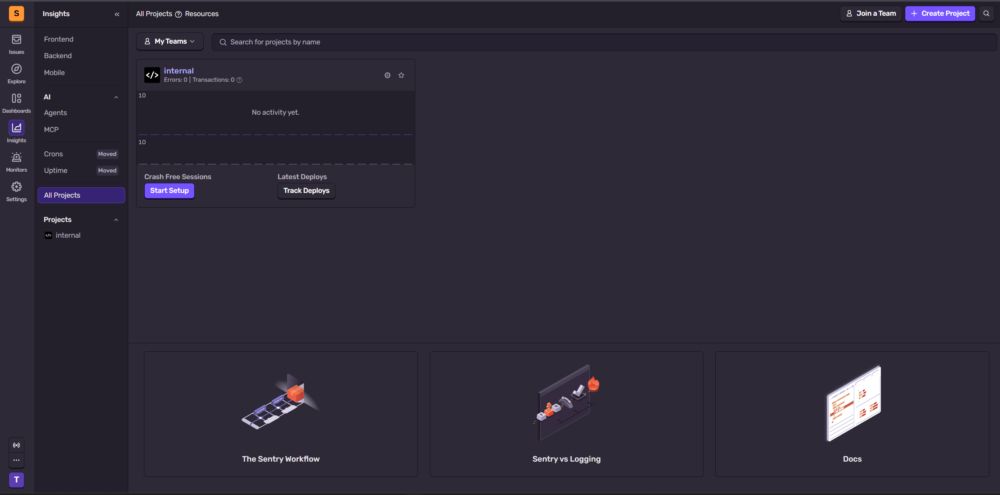
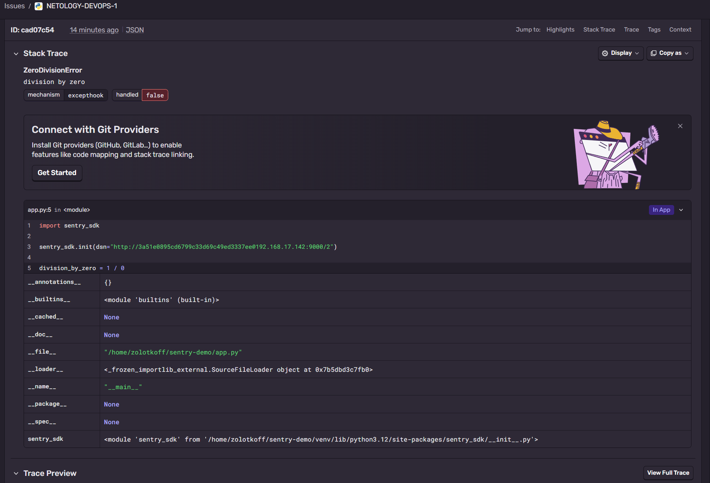
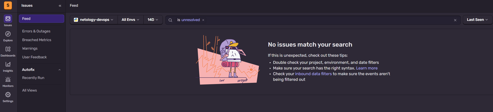
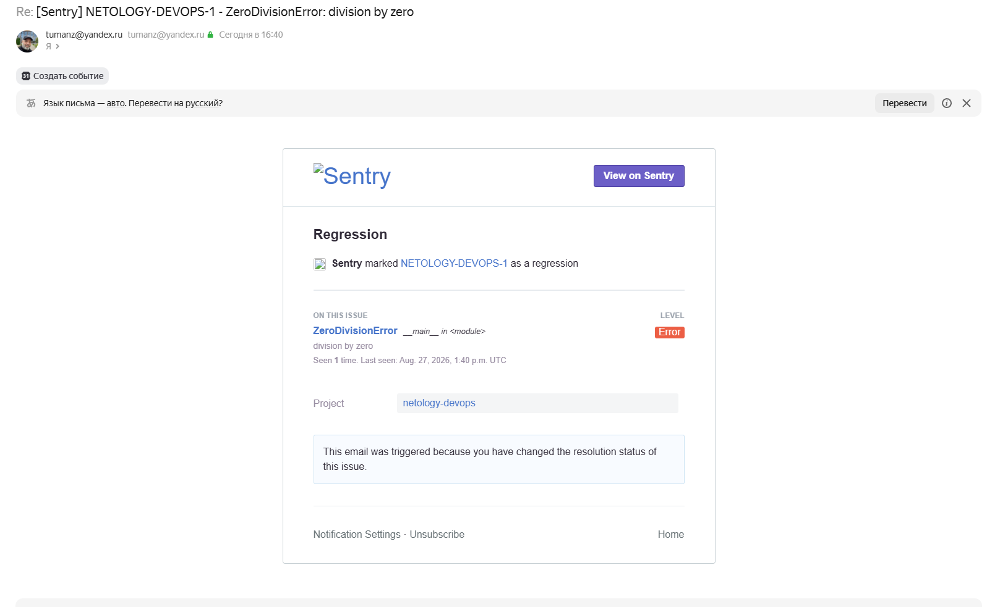

# Домашнее задание к занятию 16 «Платформа мониторинга Sentry»

## Отступление: почему Self-Hosted вместо Free Cloud

Задание предполагает регистрацию на sentry.io и работу с бесплатным облачным аккаунтом.
Однако сервис оказался недоступен: при обращении к `sentry.io` возвращается `403 Forbidden`
от Google Cloud Load Balancer.

Проверка выполнялась со всех доступных каналов:

| Канал | Результат |
|---|---|
| Домашний интернет (прямое подключение) | `403` |
| Мобильный интернет | `403` |
| VPN-прокси на Windows-машине | `403` |
| Xray (VLESS+Reality), выход в Амстердаме | `403` |
| ВМ в Yandex Cloud, внешний IP | `403` |

```bash
$ curl -s -m 10 --socks5-hostname 127.0.0.1:10808 -D - -o /dev/null https://sentry.io | head -5
HTTP/2 403
content-type: text/html; charset=UTF-8
content-length: 134
via: 1.1 google
```

Заголовок `via: 1.1 google` указывает на блокировку средствами Google Cloud Armor на стороне
сервиса. Поскольку `403` приходит и с домашних, и с мобильных, и с облачных адресов, речь
о региональном ограничении, которое не обходится сетевыми средствами.

Поэтому задание выполнено на **Self-Hosted Sentry 26.8.0**, развёрнутом на отдельной
виртуальной машине.

---

## Развёртывание Self-Hosted Sentry

### Виртуальная машина

Под Sentry поднята отдельная ВМ `prn-ubuntu-02` на гипервизоре VMware ESXi:

| Параметр | Значение |
|---|---|
| ОС | Ubuntu 24.04 LTS |
| vCPU | 4 |
| RAM | 32 GB |
| Swap | 19 GB |
| Диск | 100 GB (LVM, `/` — 98 GB) |

Официальные требования — 4 ядра, 16 GB RAM плюс 16 GB swap, 20 GB диска. Изначально ВМ была
собрана с 16 GB RAM, но этого не хватило (см. раздел «Разбор проблем»), и объём был увеличен
до 32 GB.

### Подготовка хоста

```bash
# Docker с официального репозитория — версия из репозиториев Ubuntu слишком старая
curl -fsSL https://get.docker.com | sudo sh
sudo usermod -aG docker $USER

# ClickHouse требует поддержки SSE 4.2 — на ESXi зависит от настроек совместимости CPU
grep -o sse4_2 /proc/cpuinfo | head -1
```

```
sse4_2
```

Проверка версий:

```bash
$ docker compose version
Docker Compose version v5.5.0
$ nproc
4
$ free -h
               total        used        free      shared  buff/cache   available
Mem:            31Gi        15Gi        13Gi        28Mi       2.2Gi        15Gi
Swap:           19Gi          0B        19Gi
```

### Установка

```bash
git clone https://github.com/getsentry/self-hosted.git
cd self-hosted
git checkout 26.8.0        # релизный тег вместо нестабильного master
tmux new -s sentry         # установка идёт 30-50 минут, tmux защищает от обрыва SSH
./install.sh
```

Установщик выполняет pre-flight проверки, скачивает около 20 образов, поднимает Kafka,
ClickHouse, Postgres, Redis, прогоняет миграции и предлагает создать учётную запись
администратора. Итого разворачивается порядка 40 контейнеров.

Запуск стека:

```bash
docker compose up -d
```

### Настройка

**Root URL.** По умолчанию `system.url-prefix` указывает на `localhost`, из-за чего при
заходе по IP форма входа возвращает `CSRF Validation Failed`. Исправляется в
`sentry/config.yml`:

```yaml
system.url-prefix: 'http://192.168.17.142:9000'
```

**SMTP.** Для задания 3 нужны письма-оповещения. Встроенный контейнер `smtp` отправляет почту
напрямую с хоста, что почтовые сервисы не принимают. Настроена отправка через Яндекс —
`sentry/config.yml`:

```yaml
mail.backend: 'smtp'
mail.host: 'smtp.yandex.ru'
mail.port: 465
mail.username: 'tumanz@yandex.ru'
mail.password: '<пароль приложения>'
mail.use-tls: false
mail.use-ssl: true
mail.from: 'tumanz@yandex.ru'
```

Отдельная тонкость: в `sentry/sentry.conf.py` строка 348 жёстко перезаписывает адрес
отправителя значением `sentry@localhost`, игнорируя конфиг:

```python
SENTRY_OPTIONS["mail.from"] = f"sentry@{SENTRY_OPTIONS['mail.list-namespace']}"
```

Яндекс отвергает письма, где адрес отправителя не совпадает с учётной записью, поэтому строка
закомментирована — тогда работает значение из `config.yml`.

Проверка отправки:

```bash
printf 'To: tumanz@yandex.ru\nSubject: Sentry SMTP test\n\nПроверка отправки почты.\n' > /tmp/test-mail.txt
docker compose exec -T web sentry sendmail < /tmp/test-mail.txt
```

Письмо доставлено.

---

## Задание 1. Меню Projects

Созданы два проекта: `internal` (создаётся установщиком автоматически) и `netology-devops`
на платформе Python.



---

## Задание 2. Событие и Stack trace

В версии 26.8.0 кнопка `Generate sample event` доступна на пустом экране Issues, но для
наглядности событие сгенерировано собственным скриптом — тогда stack trace указывает
на реальный код.

```bash
mkdir -p ~/sentry-demo && cd ~/sentry-demo
python3 -m venv venv
source venv/bin/activate
pip install sentry-sdk
```

`app.py`:

```python
import sentry_sdk

sentry_sdk.init(dsn="http://<ключ>@192.168.17.142:9000/2")

division_by_zero = 1 / 0
```

```bash
$ python app.py
Traceback (most recent call last):
  File "/home/zolotkoff/sentry-demo/app.py", line 5, in <module>
    division_by_zero = 1 / 0
                       ~~^~~
ZeroDivisionError: division by zero
```

Событие появилось в Issues проекта `netology-devops`.

### Stack trace



В событии видны:

- тип и сообщение исключения — `ZeroDivisionError: division by zero`;
- механизм перехвата — `excepthook`, флаг `handled: false` (исключение необработанное);
- фрейм `app.py:5 in <module>` с исходным кодом и подсвеченной строкой;
- локальные переменные фрейма (`__file__`, `__name__`, загруженные модули);
- разделы Tags, Context, Trace Preview.

### Список событий после Resolve



---

## Задание 3. Правило алертинга

Создано дефолтное правило: **Alerts → Create Alert Rule**, проект `netology-devops`,
тип Issues, все условия оставлены со значениями по умолчанию (`all`).

Правило по умолчанию срабатывает на первое появление issue. Поскольку событие из задания 2
было переведено в Resolved, повторный запуск скрипта переоткрывает issue, что также является
триггером:

```bash
python app.py
```

Оповещение доставлено на почту, привязанную к учётной записи:



---

## Разбор проблем

### Нехватки памяти при 16 GB

Изначально ВМ была собрана с 16 GB RAM — формальным минимумом из документации. При этом объёме
стек поднимался, все контейнеры показывали статус `Up`, но события не доходили до хранилища.

```bash
$ free -h
               total        used        free      shared  buff/cache   available
Mem:            15Gi        13Gi       246Mi        16Mi       2.1Gi       2.0Gi
Swap:           15Gi       3.7Gi        12Gi
```

Свободно 246 MiB, своп используется. Сервис `web` отвечал слишком медленно, из-за чего Relay
не укладывался в таймауты. После увеличения RAM до 32 GB проблема ушла.

Практический вывод: заявленные 16 GB — оптимистичная оценка. Реальный рабочий объём для этого
стека начинается от 24-32 GB.

### Relay не проходит авторизацию

Симптом: SDK успешно отправляет события (`Sending envelope ... project:2`), но в Issues пусто,
а в ClickHouse ноль записей.

```bash
$ docker compose exec clickhouse clickhouse-client --query "SELECT count() FROM default.errors_local"
0
```

Логи Relay:

```
ERROR relay_server::services::health_check: Health check probe 'auth' failed
WARN  relay_server::services::upstream: network outage, scheduling another check in 2.25s
WARN  relay_server::services::projects::source::upstream: error fetching project state ...:
      deadline exceeded errors=0 pending=272
```

Relay не смог зарегистрироваться на upstream (`web`) при старте и ушёл в режим `network
outage`, из которого самостоятельно не выходит. События при этом принимаются, но остаются
в Relay, поскольку он не знает конфигурацию проекта.

Путь события внутри Sentry:

```
SDK → Relay → Kafka → consumers → ClickHouse + Postgres → Issues
```

Обрыв на первом звене останавливает всю цепочку, при этом все контейнеры остаются в статусе
`Up` — обычные проверки состояния проблему не показывают.

### Рассинхронизация системного времени

При диагностике обнаружилось, что записи в логах идут не по порядку: строка с временем
`11:20:20` появилась после строки `12:16:58`. Часы виртуальной машины ушли назад почти на час
после перезагрузки (следствие конфликта между синхронизацией VMware Tools с хостом ESXi
и systemd-timesyncd).

Авторизация Relay использует подписанные запросы с временными метками, поэтому расхождение
часов ломает регистрацию.

```bash
sudo timedatectl set-ntp true
sudo systemctl restart systemd-timesyncd
timedatectl status
```

```
System clock synchronized: yes
              NTP service: active
```

После синхронизации времени и полного перезапуска стека Relay зарегистрировался корректно,
и события пошли:

```bash
$ docker compose exec clickhouse clickhouse-client --query "SELECT count() FROM default.errors_local"
1
```

---

## Выводы

- Self-Hosted Sentry — тяжёлая система: около 40 контейнеров, Kafka, ClickHouse, Postgres,
  Redis и десятки consumer'ов на одной машине. Заявленный минимум в 16 GB RAM на практике
  недостаточен.
- Статус `Up` у всех контейнеров не означает работоспособность системы. Конвейер обработки
  событий может стоять при формально исправных сервисах — диагностировать нужно по логам
  конкретных звеньев и по наличию данных в хранилище.
- Компоненты, использующие подписанные запросы (Relay), критичны к синхронизации времени.
  На виртуальных машинах стоит сразу определиться с единственным источником времени: либо
  синхронизация с гипервизором, либо NTP в гостевой ОС, но не оба сразу.
- Sentry принципиально отличается от систем, изученных ранее в блоке: Prometheus собирает
  метрики (числовые ряды состояния), Elastic Stack — логи (поток текстовых событий), Sentry
  же работает с исключениями, группируя их в issues с полным контекстом — stack trace,
  локальными переменными, breadcrumbs и информацией о среде выполнения. Это делает его
  инструментом не наблюдения за инфраструктурой, а отладки приложений в продакшене.

### Известные ограничения решения

- Пароль приложения SMTP хранится в открытом виде в `sentry/config.yml`. Для учебного стенда
  допустимо, в production выносится в secrets.
- Правка `sentry/sentry.conf.py` (закомментированная строка 348) будет перезаписана
  при обновлении Sentry — при апгрейде потребуется применить её заново.
